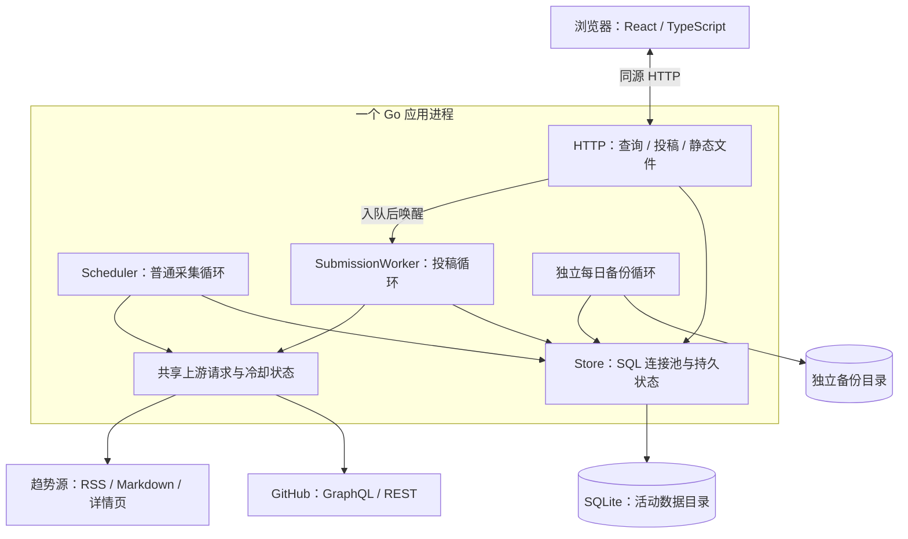
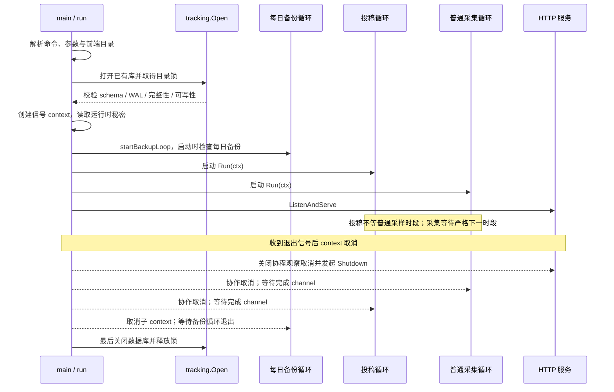
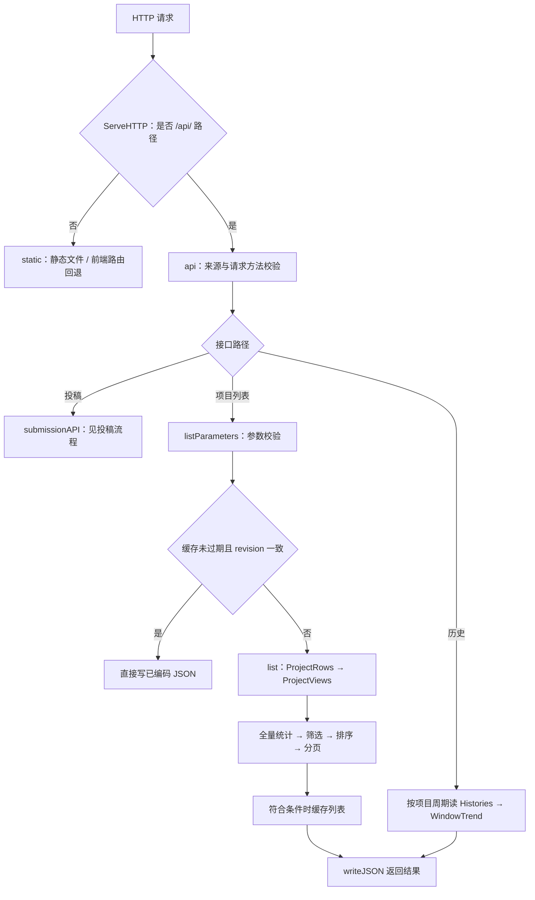
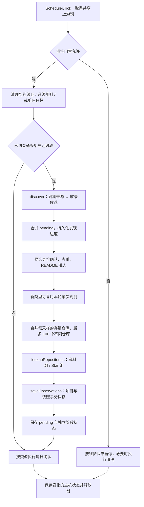
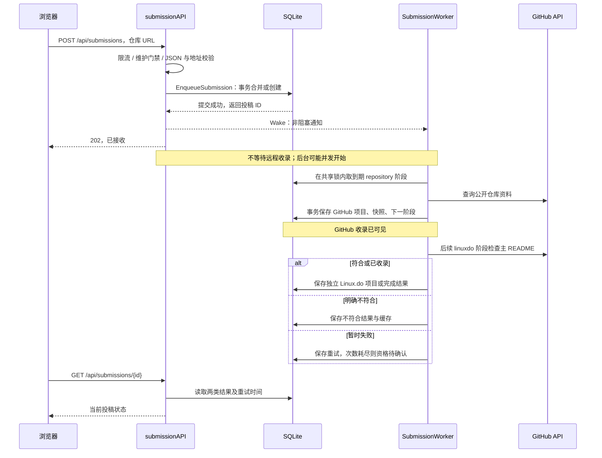
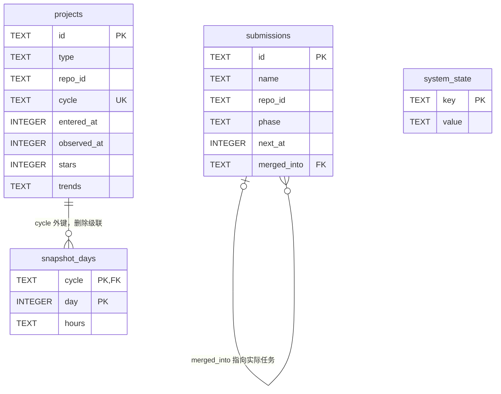
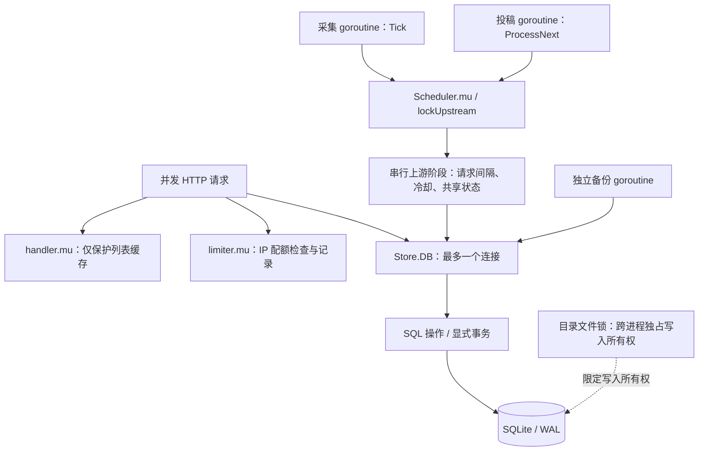
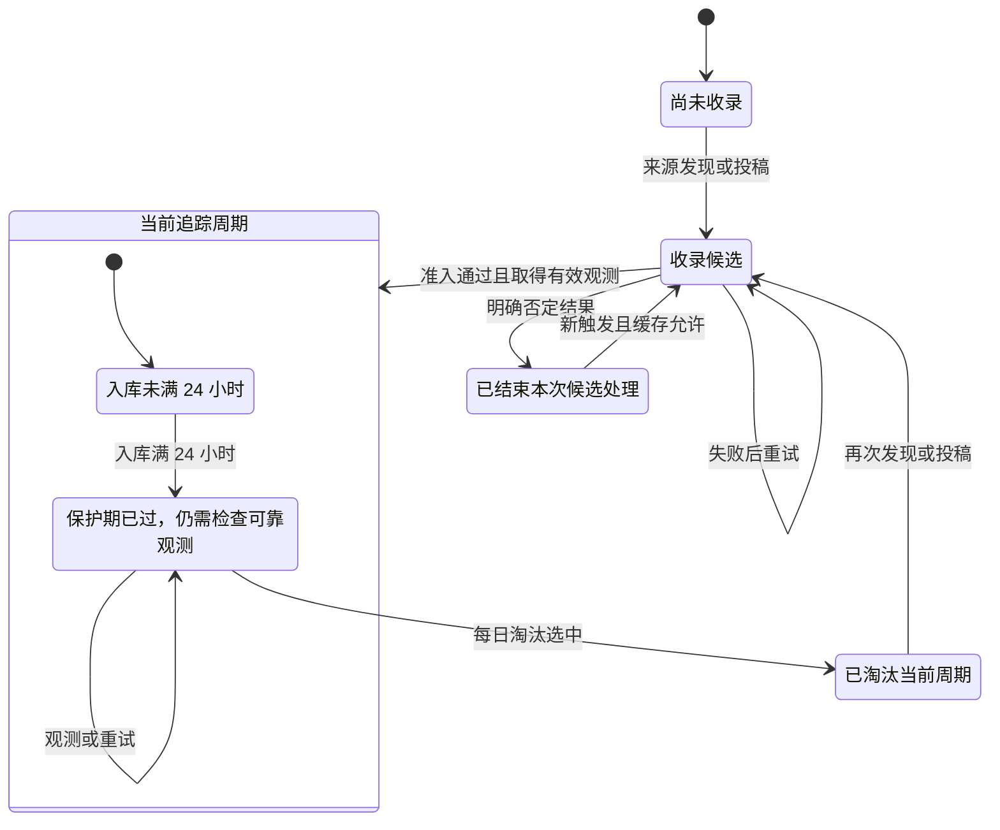

# 从 Java 到 Go：项目源码学习指南

这份指南面向有多年 Java 开发经验、刚开始学习 Go 的读者。目标是让你顺着一个真实项目，理解业务如何运行，以及 Go 代码为什么这样写。

建议把本文和源码并排打开：先看图与调用链，再跳到对应文件搜索函数名，最后阅读函数内已经补充的中文注释。本文中的链接都指向仓库文件，不绑定行号；函数名是进一步定位的依据。

**阅读约定**：图表示主要关系，分支细节在图后解释；`A → B` 表示调用或业务步骤，不一定代表新线程；时间示例使用北京时间，代码中的业务时间戳通常是 Unix 毫秒。本文描述当前实现，历史兼容规则会单独说明。

目录：

- [1. 四阶段阅读路线](#1-四阶段阅读路线)
- [2. 代码地图与整体架构](#2-代码地图与整体架构)
- [3. 启动与退出](#3-启动与退出)
- [4. 一次页面查询](#4-一次页面查询)
- [5. 一次自动采集](#5-一次自动采集)
- [6. 一次用户投稿](#6-一次用户投稿)
- [7. 数据模型与共享观测](#7-数据模型与共享观测)
- [8. 并发与持久化](#8-并发与持久化)
- [9. 趋势与项目生命周期](#9-趋势与项目生命周期)
- [10. 备份恢复与迁移](#10-备份恢复与迁移)
- [11. Go 与 Java 知识索引](#11-go-与-java-知识索引)
- [12. 用现有测试验证理解](#12-用现有测试验证理解)
- [13. 阅读自检与答案](#13-阅读自检与答案)

GitHub 支持渲染下文的 Mermaid 图；在编辑器中阅读时需使用支持 Mermaid 的 Markdown 预览。即使只看源文本，每幅图后的步骤说明也可以独立阅读。

## 1. 四阶段阅读路线

不要一开始就从头读完最大的文件。每次先带着一个具体问题进入源码。

| 阶段 | 带着什么问题阅读 | 源码顺序与函数 | 对应测试 |
| --- | --- | --- | --- |
| 第一阶段：启动与查询 | 谁创建对象？一个请求如何得到 JSON？ | [main.go](../cmd/trending/main.go) `main/run` → [store.go](../internal/tracking/store.go) `Open` → [http.go](../internal/tracking/http.go) `Handler/ServeHTTP/api/list` | [http_test.go](../internal/tracking/http_test.go) `TestEmptyDatabaseIsExplicitAndTypeQueriesRemainReadOnly` |
| 第二阶段：采集与持久化 | 数据从哪里来？什么时候写库？ | [scheduler.go](../internal/tracking/scheduler.go) `Run/Tick/collect` → [discovery.go](../internal/tracking/discovery.go) `discover` → [upstream.go](../internal/tracking/upstream.go) `text/lookupRepositories` → [observations.go](../internal/tracking/observations.go) `saveObservationsAnd` | [scheduler_test.go](../internal/tracking/scheduler_test.go) `TestSchedulerWaitsForNextSlotAndAdmitsWithActualObservation` |
| 第三阶段：投稿与并发 | 为什么请求能先返回？哪些状态共享？ | [submissions_http.go](../internal/tracking/submissions_http.go) `submissionAPI` → [submissions.go](../internal/tracking/submissions.go) `EnqueueSubmission` → [submissions_worker.go](../internal/tracking/submissions_worker.go) `ProcessNext` → `Scheduler.lockUpstream` | [submissions_worker_test.go](../internal/tracking/submissions_worker_test.go) `TestSubmissionAdmissionIndependentStages` |
| 第四阶段：趋势及维护 | 怎样解释历史？为什么有些项目不淘汰？ | [trends.go](../internal/tracking/trends.go) `WindowTrend/ProjectViews` → [retention.go](../internal/tracking/retention.go) `cleanup` → [backup.go](../internal/tracking/backup.go) `Backup/Restore` | [sampling_test.go](../internal/tracking/sampling_test.go)、[backup_test.go](../internal/tracking/backup_test.go) |

第一遍达到“能解释主流程”即可。第二遍再跟踪错误分支、事务与资源释放。第三遍用第 12 节的测试观察边界情况，不必等待真实采样时段。

## 2. 代码地图与整体架构

### 2.1 仓库中的 Go 代码

```text
cmd/trending/                 可执行程序：解析参数、组装依赖、管理生命周期
├── main.go
└── backup.go
internal/tracking/            核心业务包：以下文件共同组成一个 package
├── store.go                  SQLite、目录锁、持久状态和基础查询
├── http.go                   项目查询、JSON、列表缓存、静态文件
├── scheduler.go              普通采集调度与共享上游锁
├── discovery.go              趋势源解析与候选发现
├── upstream.go               HTTP/GraphQL、超时、主机间隔与冷却
├── observations.go           项目、快照、趋势与检查点事务写入
├── trends.go                 采样时间表、缺测、过期与趋势计算
├── retention.go              按追踪类型独立淘汰
├── linuxdo.go                README 准入与不符合缓存
├── linuxdo_cleanup.go        一次性存量清洗与维护门禁
├── unavailable.go            公开不可访问候选缓存与匿名复核
├── submissions.go            投稿规范化、入队、查询与持久化
├── submissions_http.go       投稿 HTTP、IP 限流和可信代理
├── submissions_worker.go     投稿后台阶段处理
├── backup.go                 一致快照、离线恢复、每日备份判定
├── audit.go                  全量物理数据审计
├── migrate.go                离线 schema 升级
├── http_test.go
├── scheduler_test.go
├── sampling_test.go
├── linuxdo_rss_test.go
├── linuxdo_test.go
├── unavailable_test.go
├── submissions_test.go
├── submissions_worker_test.go
├── backup_test.go
└── process_test.go
migrations/
└── embed.go                  将同目录 SQL 文件嵌入 Go 二进制
```

下面的表补充文件中的具体职责，测试按业务归组。

| 子系统 | 文件与主要入口 | 应配合阅读的测试 |
| --- | --- | --- |
| 程序入口 | [main.go](../cmd/trending/main.go) `run` 组装服务；[命令行 backup.go](../cmd/trending/backup.go) `backupCommand/startBackupLoop` 连接备份功能 | 当前 `cmd/trending` 无独立测试；数据库与备份通过业务包测试覆盖 |
| 存储与审计 | [store.go](../internal/tracking/store.go) `Open/State/ProjectRows/Histories`；[audit.go](../internal/tracking/audit.go) `Audit`；[migrate.go](../internal/tracking/migrate.go) `Migrate`；[embed.go](../migrations/embed.go) `Files` | [process_test.go](../internal/tracking/process_test.go) 验证跨进程锁；[submissions_test.go](../internal/tracking/submissions_test.go) 验证升级与回滚 |
| HTTP 查询 | [http.go](../internal/tracking/http.go) `Handler/api/list/static` | [http_test.go](../internal/tracking/http_test.go) 验证请求边界、空列表与缓存 |
| 发现与采样 | [scheduler.go](../internal/tracking/scheduler.go) `Tick/collect`；[discovery.go](../internal/tracking/discovery.go) `discover/parseSource`；[upstream.go](../internal/tracking/upstream.go) `text/lookupRepositories` | [scheduler_test.go](../internal/tracking/scheduler_test.go) 验证主流程；[linuxdo_rss_test.go](../internal/tracking/linuxdo_rss_test.go) 验证多入口、冷却、部分失败 |
| 观测与趋势 | [observations.go](../internal/tracking/observations.go) `saveObservationsAnd`；[trends.go](../internal/tracking/trends.go) `NextSlot/WindowTrend/ProjectViews`；[retention.go](../internal/tracking/retention.go) `cleanup` | [sampling_test.go](../internal/tracking/sampling_test.go) 验证历史规则边界；[scheduler_test.go](../internal/tracking/scheduler_test.go) 验证独立历史、淘汰和迟到结果 |
| 准入与维护 | [linuxdo.go](../internal/tracking/linuxdo.go) `linuxdoReadme`；[linuxdo_cleanup.go](../internal/tracking/linuxdo_cleanup.go) `linuxdoGate/cleanLinuxdo`；[unavailable.go](../internal/tracking/unavailable.go) `publicRepository` | [linuxdo_test.go](../internal/tracking/linuxdo_test.go)、[unavailable_test.go](../internal/tracking/unavailable_test.go) |
| 投稿 | [submissions_http.go](../internal/tracking/submissions_http.go) `submissionAPI`；[submissions.go](../internal/tracking/submissions.go) `EnqueueSubmission/Submission`；[submissions_worker.go](../internal/tracking/submissions_worker.go) `ProcessNext` | [submissions_test.go](../internal/tracking/submissions_test.go)、[submissions_worker_test.go](../internal/tracking/submissions_worker_test.go) |
| 备份恢复 | [业务 backup.go](../internal/tracking/backup.go) `Backup/Restore/BackupRunner.Tick`，借助 `Audit` 比较完整数据 | [backup_test.go](../internal/tracking/backup_test.go) 验证 WAL 一致性、恢复与轮转 |

### 2.2 图一：整体架构



图中有三个后台业务循环，但并不代表三套独立的上游限额：采样与投稿共享 `Scheduler` 的锁和 `upstream` 状态。每日备份独立计时，但仍使用同一个 `Store`。查询读取 SQLite，浏览器不会直接持有 GitHub Token。

**源码对照**：[main.go](../cmd/trending/main.go) `run`，以及上述 `Handler`、`NewScheduler`、`NewSubmissionWorker`、`startBackupLoop`。**测试对照**：[submissions_worker_test.go](../internal/tracking/submissions_worker_test.go) `TestSubmissionPrivacyFailuresAndRateLimitRecovery`；[backup_test.go](../internal/tracking/backup_test.go) `TestDailyBackupRunsDuringCollectionStartupWaitAndSurvivesRestart`。

### 2.3 从 Java 包和类切换到 Go 的组织方式

[go.mod](../go.mod) 中的 `module github.com/lizhian/github-trending-tracking` 是导入路径的根。`cmd/trending` 使用 `package main`，编译为可执行程序；`internal/tracking` 中的业务文件共同组成 `package tracking`。文件名只是组织代码的方式，不创建独立命名空间。

因此，`scheduler.go` 可以直接调用 `discovery.go` 的小写函数 `discover`。这不是访问另一个类的 private 方法：它们本来就在同一个包里。包外调用者需要导入完整路径，并通过 `tracking.NewScheduler` 等大写名称访问导出能力。

`internal` 还有导入边界：位于其父目录树之外的代码不能导入这个内部包。它不是 Java 的 `private` 类修饰符，也不要求把所有文件都改成小写名称。

对象组装是显式的：`run` 创建 `Store`，再把它传给调度器和 HTTP 处理器。理解为手动依赖注入即可，这里没有 Spring 容器自动发现和装配 Bean。

## 3. 启动与退出

### 3.1 图二：启动时序



`Open` 不会自动创建空库，也不自动迁移旧 schema。初始化由 `init` 命令显式完成，升级由 `migrate` 完成；正常服务启动只接受符合当前版本的已有数据库。

普通采集从 `NextSlot(startedAt)` 开始。例如 11:10 启动等 12:00；12:00 整启动也等待 13:00。约每分钟 `Tick` 一次与每天十八个应采时段是两回事：前者检查“现在有没有工作”，后者定义观测轮次。启动等待期间，HTTP、每日备份和符合门禁条件的常规清理仍可工作。投稿不受普通采样启动门槛限制，但仍受清洗维护门禁约束。

退出依靠协作取消。`context` 不会强行终止 goroutine；循环与请求需要检查它。`run` 的 `defer` 按后登记先执行的顺序，先等待调度/投稿和备份循环，再释放数据库。HTTP 的 `Shutdown` 使用新的十秒超时上下文，因为原任务上下文已经取消。当前入口通过独立 goroutine 发起 HTTP 关闭，并没有另外 join 等待 `Shutdown` 调用返回；不要把示意图读成代码对所有请求完成作出了额外保证。

**源码对照**：[main.go](../cmd/trending/main.go) `main/run/runtimeSecret`；[命令行 backup.go](../cmd/trending/backup.go) `startBackupLoop`；[store.go](../internal/tracking/store.go) `Open/Close`。**测试对照**：[scheduler_test.go](../internal/tracking/scheduler_test.go) `TestSchedulerWaitsForNextSlotAndAdmitsWithActualObservation`，以及 [process_test.go](../internal/tracking/process_test.go) `TestAnotherProcessCannotWriteTheDataDirectory`。它们分别验证采样启动门槛和跨进程目录锁，并不等同于完整的进程信号退出测试。

### 3.2 从最小函数认识 Go

以下摘自 [main.go](../cmd/trending/main.go) 的 `env`，省略函数内已有的说明注释：

```go
func env(key, def string) string {
	if value := os.Getenv(key); value != "" {
		return value
	}
	return def
}
```

`key, def string` 表示两个参数都是 string，返回类型放在参数列表后。`:=` 声明变量并推断类型。这里 `value` 属于 `if` 的作用域，函数后面不能再引用它。调用方传递字符串默认值，这比把“读取环境变量失败”与“未设置变量”混为异常更容易顺着代码追踪。

继续读 `run` 时关注 `store, err := tracking.Open(*path)`：它一次取得两个返回值。只有确认 `err == nil` 后，才使用 `store` 并登记清理。`flags.String` 返回 `*string`，因此 `*path` 是读取指针指向的字符串值。

## 4. 一次页面查询

### 4.1 图三：查询流程



列表调用链是 `Handler → (*handler).ServeHTTP → api → (*Store).list → ProjectRows/ProjectViews`。`Handler` 是构造函数，`handler` 是具体类型；它不需要声明 `implements http.Handler`，只要拥有正确签名的 `ServeHTTP` 方法即可。

列表先以追踪类型筛选数据库行，再对该类型全量项目生成统计、语言与 Topics 选项，之后应用搜索与筛选、排序和分页。所以搜索后页面只剩一条，也不意味着运行状态只看这一条。历史接口则先取得项目当前 `cycle`，再按该周期读取快照，避免混入淘汰前的历史。

列表内存缓存同时检查十分钟有效期与 `listRevision`。初始没有任何追踪项目的类型不缓存，避免首次收录后仍显示空库；已有项目但搜索零匹配的结果可以缓存。成功收录等受实现支持的数据变化会递增版本，让旧缓存提前失效。浏览器响应的 `Cache-Control: no-store` 与服务器进程内缓存属于不同层次。

错误处理也分层：参数错误返回 400，找不到项目返回 404，数据暂不可用返回安全的 503 提示。读取失败不会自动触发 GitHub 请求来“顺便修复数据”。

**源码对照**：[http.go](../internal/tracking/http.go) `Handler/ServeHTTP/api/list/writeJSON`；[store.go](../internal/tracking/store.go) `ProjectRows/Histories`；[trends.go](../internal/tracking/trends.go) `ProjectViews/WindowTrend`。**测试对照**：[http_test.go](../internal/tracking/http_test.go) `TestInitialEmptyTypeIsNotCachedAndNonemptyQueriesExpire`。

### 4.2 JSON 与类型的三个层次

| 数据阶段 | 项目中的类型 | 为什么区分 |
| --- | --- | --- |
| 上游响应 | `repository` | 对应 GraphQL 嵌套结构，不完整响应可能有 nil 字段 |
| 数据库原始行 | `ProjectRow` | `Topics/Trends` 是持久化的 JSON 文本 |
| 对外查询视图 | `Project` | 已解码 Topics、趋势摘要，并计算当前过期状态 |

`Description *string` 中 nil 与指向空字符串不同。类似地，`Delta *int64` 中 nil 表示积累中，指向 0 则表示可以比较但净增量为零。不要为了“减少指针”把这两种语义合并。

`[]string{}` 会编码成 `[]`，nil slice 默认编码成 `null`。查询代码显式初始化空集合，是为了稳定前端契约。测试把 JSON 解码到 `map[string]any` 时，普通 JSON 数字默认是 `float64`，因此看到 `got["total"] != float64(1)` 不代表数据库把整数存成了浮点数。

## 5. 一次自动采集

### 5.1 图四：自动采集流程



图省略了提前返回的数据库错误分支；实际由 `defer` 调用 `finish` 负责最终保存主机状态与解锁。没有到普通采集启动时段会跳过整个 `collect`，包括来源发现；这与“某个来源的 NextAt 已到”还不是同一层条件。

**源码对照**：[scheduler.go](../internal/tracking/scheduler.go) `Tick/collect/lockUpstream`；[discovery.go](../internal/tracking/discovery.go) `discover`；[observations.go](../internal/tracking/observations.go) `saveObservationsAnd`。**测试对照**：[scheduler_test.go](../internal/tracking/scheduler_test.go) `TestCandidateAndSamplingFailuresHaveIndependentStatus`、`TestHundredRepositoryBatchesUpdateBothTypesAndCompletedRoundStaysIdle`。

### 5.2 分五步读较长的 collect

**第一步，发现候选。** `discover` 从到期趋势源获取仓库名。GitHub RSS 取约定的链接位置，Linux.do 提取正文链接，HelloGithub 先解析详情页的权威数据。发现不等于收录，正文中的依赖链接也只是候选。

Linux.do 的七个固定 RSS 入口合起来是一个趋势源，要全部遍历并去重。部分失败时仍处理成功入口的候选，但不刷新整组成功时间，至少五分钟后重试整组。它不是某个入口成功就停止的主备模式。发现共用三分钟预算，预算耗尽属于延后，不能据此新增真实请求失败。

**第二步，确认身份和准入。** 合并旧 `pending` 与新发现候选，排除附件等非法路径，按稳定 GitHub 节点 ID 消除改名造成的重复。Linux.do 还要通过 `linuxdoReadme`：默认分支的主 README 必须包含大小写敏感字面子串 `https://linux.do`。当前是字面匹配，代码块、注释甚至包含该前缀的更长文本也算；不能自行当成严格域名解析。

**第三步，复用或获取观测。** 对已通过准入的新类型，可复用同一轮已有的一个真实观测。剩余候选与需更新的存量项目按仓库 ID 合并，每批最多 100 个不同仓库。元数据至少间隔 24 小时刷新；只采 Star 的请求保留已有资料。GraphQL 部分节点失败，不应丢弃同批有效节点。

**第四步，事务写入。** `saveObservationsAnd` 先读取需要的旧历史，再开启事务，更新项目、小时快照和窗口摘要。已有项目更新带原 `cycle` 和时间条件，迟到结果不能覆盖替代周期。每天的快照保存在 UTC 日桶的 JSON 小时键中；同小时只保留更新的观测。

**第五步，保存后续工作。** 候选、主机冷却和阶段状态持久化，使下次 Tick 或进程重启能遵守已有截止时间。整个 `collect` 不是一个覆盖所有网络操作的大事务：发现进度、观测批次、最终候选状态有各自明确的事务边界。它们都在普通采样与投稿的共享上游锁范围内运行。

### 5.3 三类失败不能混为一谈

| 阶段 | 状态名 | 失败意味着什么 |
| --- | --- | --- |
| 来源发现 | `discovery` | RSS 等趋势源暂时读取或解析失败 |
| 候选准入 | `admission` | 尚未收录候选的身份、资格或首个观测待确认 |
| 存量观测 | `collection` | 已追踪项目本次 Star 更新失败，仍保留此前有效数据 |

再区分三种准入结果：

- **明确不符合 README 资格**：正常判定完成，不创建 Linux.do 项目；缓存 24 小时。
- **请求失败待确认**：继续重试，不能因权限或超时就删除项目或生成不符合缓存。
- **仓库明确公开不可访问**：带 Token 查询明确 NOT_FOUND，且匿名仓库请求也返回 404，才结束未收录候选并缓存 24 小时；不等于断言作者删库。

README 文件 404 本身不能证明仓库不存在。匿名复核还要检查仓库身份，防止旧名字已被另一仓库复用。请求重试至少五分钟，并服从更晚的 `Retry-After`/额度重置及主机冷却；不符合缓存和不可访问缓存到期都不会自己触发扫描。

继续阅读：[linuxdo.go](../internal/tracking/linuxdo.go) `linuxdoReadme`；[unavailable.go](../internal/tracking/unavailable.go) `publicRepository`；[upstream.go](../internal/tracking/upstream.go) `cooldown/lookupRepositories`。对应 [linuxdo_test.go](../internal/tracking/linuxdo_test.go)、[unavailable_test.go](../internal/tracking/unavailable_test.go) 的资格与复核场景。

## 6. 一次用户投稿

### 6.1 图五：投稿时序



202 只承诺投稿已持久化接收或合并到已有活跃任务。新投稿默认 `phase=repository`，资料成功后先提交 GitHub 收录，再把投稿推进到 `linuxdo` 阶段。消费者成功处理一个阶段后可立即继续，不固定等待 30 秒；没有到期任务时才等唤醒或扫描计时器。

两阶段分别最多尝试三次，实际限流与延后不消耗次数；上下文取消也不能算一次业务失败。README 最终待确认不会撤销已经成功的 GitHub 收录。已收录 Linux.do 的仓库不因重复投稿重新检查 README，也不重置现有周期/保护期。

同名活跃投稿入队时合并；资料查询确认稳定 ID 后还可能把别名并入另一活跃任务。原请求 ID 继续解析到实际任务，完成结果保留七天。主动投稿绕过仓库不可访问缓存，确认公开可访问后清除原名和规范名缓存；但它仍遵守 README 不符合缓存。

**源码对照**：[submissions_http.go](../internal/tracking/submissions_http.go) `submissionAPI`；[submissions.go](../internal/tracking/submissions.go) `EnqueueSubmission/Submission`；[submissions_worker.go](../internal/tracking/submissions_worker.go) `ProcessNext/repositoryStage/linuxdoStage/admit/checkpoint`。**测试对照**：[submissions_worker_test.go](../internal/tracking/submissions_worker_test.go) `TestSubmissionAdmissionIndependentStages`、`TestSubmissionAdmissionCheckpointIsAtomicAndCancellationIsFree`。接口与部署参数见[投稿说明](submissions.md)。

### 6.2 通知为什么可以丢，任务为什么不会丢

摘自 [submissions_worker.go](../internal/tracking/submissions_worker.go) 的 `Wake`：

```go
func (w *SubmissionWorker) Wake() {
	select {
	case w.wake <- struct{}{}:
	default:
	}
}
```

`wake` 是容量为一的 channel。`struct{}{}` 是空结构体值，只表示“有新工作”，不携带投稿内容。如果已有通知，发送不能立即完成，就走 `default`，HTTP 不会被这个发送阻塞。

它不是把任务扔进一个只有一格的内存队列：任务已经在 `submissions` 表中。即使通知合并或进程重启，消费者仍会从数据库查找未完成阶段。这个区分是理解本项目并发设计的关键。

## 7. 数据模型与共享观测

### 7.1 图六：四张表的数据关系



图中只画真实表和部分字段。`snapshot_days` 的主键是 `(cycle, day)`；`projects` 还对 `(type, repo_id)` 有唯一约束。`submissions.merged_into` 是自引用外键。`system_state` 保存 JSON，没有指向其他表的外键。`submissions.repo_id` 与项目的仓库 ID 是业务关联，也没有被定义为 projects 外键。

尤其注意：**“仓库”是领域概念，当前没有独立 repositories 表**。同仓库资料可以出现在两条项目行中，代码负责共享请求结果与同步资料；不要从概念关系推导一个不存在的 ORM 实体。

| 表 | 保存什么 | 读取时应理解的边界 |
| --- | --- | --- |
| `projects` | 当前追踪项目、当前周期、资料、最后观测与趋势摘要 | `id=type + ":" + repo_id`，同仓库两类不同 ID；淘汰再收录 ID 可相同而 cycle 必须不同 |
| `snapshot_days` | 某周期某 UTC 日的小时快照 JSON | `hours` 的小时键对应 `[真实观测毫秒, Star总数]`；不是每一毫秒一条 SQL 行 |
| `system_state` | 采样规则、pending、来源进度、冷却、缓存、清洗与运行状态 | 键名定义不同协议，JSON 要解码到相应类型；不是所有 key 都是可随意丢弃的缓存 |
| `submissions` | 投稿阶段、两类结果、次数、重试时间、完成时间及别名 | 投稿结束不代表追踪周期结束；清理投稿结果也不删除 Star 历史 |

**源码对照**：[迁移目录](../migrations/) 的有序 SQL；[store.go](../internal/tracking/store.go) `ProjectRow/State/Histories`；[submissions.go](../internal/tracking/submissions.go) `Submission`。当前 schema 为 6，应按所有迁移的最终结果理解，不能只看最早建表脚本里的 `listed_at`。**测试对照**：[submissions_test.go](../internal/tracking/submissions_test.go) `TestMigrationPreservesExistingDataAndBackup`。

### 7.2 用一组数字理解“共享但独立”

假设规则已经稳定生效，时钟如下：

| 时刻 | 动作 | GitHub 追踪项目 | Linux.do 追踪项目 |
| --- | --- | --- | --- |
| 09:00 | 首次 GitHub 收录，100 Star | 周期 A；快照 `[09:00, 100]` | 尚不存在 |
| 11:00 | 采样成功，150 Star | 周期 A；新增 `[11:00, 150]` | 尚不存在 |
| 11:30 | Linux.do 候选重试成功，通过 README 准入 | 继续周期 A | 新周期 B；入库 11:30；复用快照 `[11:00, 150]` |
| 12:00 | 共同采样成功，175 Star | 新增 `[12:00, 175]` | 新增 `[12:00, 175]` |

Linux.do 没有得到 GitHub 09:00 的历史。它只复用了当前轮 11:00 的单次观测，所以在上述数据下，GitHub 可比较净增量是 75，Linux.do 是 25；窗口覆盖状态还需按各自历史判断。

Linux.do 的 `entered_at=11:30` 决定保护期，`observed_at` 最初是 11:00。11:30 的成功不能把观测时间改成 11:30，否则就伪造了一个没有实际发生的新采样点。其保护期持续到次日 11:30，届时也还要满足每日淘汰与可靠观测条件才可能被淘汰。

对应 [scheduler_test.go](../internal/tracking/scheduler_test.go) `TestSharedObservationKeepsIndependentHistoryAndAdmissionTime`。该测试采用类似场景，具体下一次执行 Tick 的时刻以测试源码为准；本表用于解释当前逐小时计划。

### 7.3 为什么先读历史再开事务

`Store` 把 `sql.DB` 最大连接数设为一。`sql.DB` 类似 JDBC 的连接池入口，不是一条一直由你独占的 JDBC Connection；`sql.Tx` 才占住某次事务使用的连接。

`saveObservationsAnd` 在 `BeginTx` 之前读取历史。若先占住唯一连接，再通过 `s.DB` 查询历史，新查询会等池中可用连接，而当前代码又要等查询才能提交，就可能等待自己。事务里的额外状态写入通过 `setTxState(ctx, tx, ...)` 使用原 `tx`，不再从池中取连接。

原子边界是：本次观测的项目行、快照、摘要，以及可选 `checkpoint` 一起提交。投稿利用这个回调让“项目已经收录”与“投稿已经推进”保持一致。它不是 Spring 的 `@Transactional` 代理：`BeginTx`、每个 error 分支、`Rollback` 和 `Commit` 都写在代码里。

对应 [observations.go](../internal/tracking/observations.go) `saveObservationsAnd/setTxState`；[submissions_worker_test.go](../internal/tracking/submissions_worker_test.go) `TestSubmissionAdmissionCheckpointIsAtomicAndCancellationIsFree` 用真实 SQLite 触发器注入检查点错误，验证不会留下半次收录。

## 8. 并发与持久化

### 8.1 图七：哪些工作可以同时进行



这几种保护机制解决不同问题：

| 机制 | 保护范围 | 不能据此推出什么 |
| --- | --- | --- |
| goroutine | 把任务交给运行时并发调度 | 不保证有自己的 OS 线程，也不自动保证共享内存安全 |
| `handler.mu` / 限流锁 | 请求间对 map 的检查与更新 | 不保护采集的主机状态，也不覆盖整个 HTTP 请求 |
| `Scheduler.mu` | 采样与投稿整个上游工作阶段，包含状态加载和最终保存 | 不是数据库事务；持锁的网络调用仍可能失败，且等待锁不支持 context 立即打断 |
| 单连接池 | 让数据库操作轮流占用一条连接 | 不使多条无事务 SQL 自动变成一次原子提交 |
| `sql.Tx` | 数据库内一组修改的提交/回滚 | 不回滚已经发出的 HTTP 请求，不保护任意 Go map |
| 目录文件锁 | 同数据目录只允许一个遵守锁约定的活跃写入进程 | 不是不可绕过的数据库权限；不直接禁止其他程序自行打开 SQLite |

WAL 有利于数据库读写协作和一致快照，但同一个 `Store` 仍只有一条连接。因此“HTTP 不等待上游锁”不表示查询永不等待：它还可能等待数据库连接。单进程中的每日备份不另取目录锁，因为该进程已经持有；离线 backup/restore/migrate 等命令则按各自入口取得独占所有权。

**源码对照**：[scheduler.go](../internal/tracking/scheduler.go) `lockUpstream`；[store.go](../internal/tracking/store.go) `database/directoryLock`；[http.go](../internal/tracking/http.go) `handler/api`；[submissions_http.go](../internal/tracking/submissions_http.go) `submissionLimiter.allow`。**测试对照**：[process_test.go](../internal/tracking/process_test.go) 的跨进程测试，[submissions_worker_test.go](../internal/tracking/submissions_worker_test.go) 的并发冷却恢复测试，以及 [backup_test.go](../internal/tracking/backup_test.go) `TestBackupIsConsistentWhileWALTransactionsCommit`。

### 8.2 重启后哪些东西还在

| 状态 | 保存位置 | 重启后的行为 |
| --- | --- | --- |
| 列表响应缓存、revision | 进程内 map / 原子计数器 | 清空，按当前库重新生成 |
| IP 一分钟限流 | 进程内 map | 清空，不是跨进程配额服务 |
| 投稿 Wake 通知 | 内存 channel | 丢失通知不丢任务，消费者扫描持久队列 |
| 投稿阶段、次数、NextAt | `submissions` | 继续未完成阶段，不等普通采样时段 |
| pending、来源进度与重试 | `system_state` | 保留已有截止时间，普通采集仍先经过重启门槛 |
| 主机 blockedUntil | `system_state` 中的 upstream | 长冷却继续生效，不因重启或换轮缩短 |
| 不符合/不可访问缓存 | `system_state` | 未过期仍有效；到期本身不发起新检查 |
| 每日备份完成情况 | 已成功验证的快照文件名，另有进程内 lastSlot | 重启先扫描并验证文件，避免同一日时段重复备份 |

### 8.3 用接口让时间可测试

摘自 [upstream.go](../internal/tracking/upstream.go) 的 `Clock`：

```go
type Clock interface {
	Now() int64
	Sleep(context.Context, time.Duration) error
}
```

它只规定使用方所需的两个动作。生产 `realClock` 与测试的模拟时钟拥有这些方法，就自动满足接口。不需要继承一个时钟基类，也不必修改类型声明来补 `implements Clock`。

在 [scheduler_test.go](../internal/tracking/scheduler_test.go) 中，`testClock.Sleep` 不真正等待，而是推进模拟毫秒。配合注入 `http.Client.Transport` 的函数替身，测试可以在几秒内完成跨日、重启、冷却和缺测验证。SQLite 保留真实实现，所以还能捕捉事务、外键和 SQL 错误。

## 9. 趋势与项目生命周期

### 9.1 图八：追踪周期生命周期



此图是领域生命周期，不是 `submissions.phase` 数据库字段的枚举。图中再次进入当前追踪周期时会创建新 `cycle`；Linux.do 的准入与不可访问缓存具体触发差异见第 5、6 节。采样失败通常让已收录项目保留旧数据，而不是自动转成“仓库不存在”并删除。

**源码对照**：[observations.go](../internal/tracking/observations.go) `saveObservationsAnd` 创建周期；[retention.go](../internal/tracking/retention.go) `cleanup` 淘汰；[trends.go](../internal/tracking/trends.go) 判断可靠观测。**测试对照**：[scheduler_test.go](../internal/tracking/scheduler_test.go) `TestCleanupRunsDuringStartupWaitProtectsYoungProjectsAndReentryStartsNewHistory`、`TestLateObservationCannotWriteIntoReplacementTrackingCycle`。

### 9.2 趋势状态分三个维度看

`WindowTrend` 先过滤最近 30 天的真实快照，再以最新成功观测作为窗口终点，计算 24、72、168、720 小时窗口。窗口内不足两个不同观测时间时，净增量为 nil，显示积累中；否则末次 Star 减基准 Star，结果可以为负。

| 维度 | 判断函数/数据 | 典型含义 |
| --- | --- | --- |
| 是否可比较、窗口覆盖够不够 | `Delta`、`CompleteWindow` | 积累中 / 部分观测 / 完整观测 |
| 窗口内部是否漏采 | `MissedSampling`、`Gaps` | 中间是否跳过应采时段 |
| 最后观测是否足够新 | `IsStale` | 是否超过下一应采时段与宽限要求 |

完整观测允许内部存在缺测；没有缺测也可能因为刚收录而只覆盖部分窗口；数据过期不必伴随请求报错。程序不把停机时段补成零、不做插值，也不回放过去每轮来“补历史”。

历史兼容要单独看：`SamplingPolicy.EffectiveAt` 与 `HourlyDaytimeAt` 记录不同采样规则的边界。旧历史按当时规则判断，避免把旧的正常两小时或四小时间隔重新解释成今天的漏采。当前时刻表在 `SamplingHours`，`legacySamplingHours` 仅用于历史解释。

### 9.3 为什么超过 500 项也未必删除

`cleanup` 按追踪类型分别在最近每日北京时间 04:00 时段执行。只有入库满 24 小时、观测未过期、真实可比较跨度足够且四窗口都有有效比较的项目才进入候选。保护期或数据不足优先于 500 项目标，所以允许暂时超额。

评分按四窗口的实际日均增长速度加权，权重依次为 `0.6/0.25/0.1/0.05`；评分时负净增量按零处理，页面仍显示真实负数。同评分再按 24 小时净增量、Star 总数、入库时间、项目 ID 升序决定淘汰顺序。删除只影响当前类型当前周期，外键级联删除该周期的历史，不触及另一个类型。

继续阅读：[trends.go](../internal/tracking/trends.go) `WindowTrend/CompleteWindow/IsStale`；[retention.go](../internal/tracking/retention.go) `cleanup`。对应 [sampling_test.go](../internal/tracking/sampling_test.go) `TestSamplingTransitionPreservesHistoricalGapsAndWindowBoundaries`，以及 [scheduler_test.go](../internal/tracking/scheduler_test.go) `TestCleanupOrdersByScoreDeltaStarsEntryTimeAndID`。

## 10. 备份恢复与迁移

这部分先理解职责，实际命令与路径配置遵循[运行、备份与恢复说明](go-runtime.md)，不在学习指南里复制生产操作步骤。

| 能力 | 实际入口与流程 | 需要理解的 Go/数据库知识 |
| --- | --- | --- |
| 新库初始化 | `Initialize` → 按顺序执行嵌入 SQL → 写 schema 版本 | `O_EXCL` 拒绝覆盖；事务成功才保留新库 |
| 一致备份 | `Store.Backup` → `VACUUM INTO` → 审计/同步 → 发布 → 轮转 | 不能只复制正在使用的主文件；WAL 已提交内容也要进入一致视图 |
| 每日调度 | `startBackupLoop` → `BackupRunner.Tick` | 独立分钟循环；固定北京时间默认 03:00；启动缺备份则补本日最近时段 |
| 离线恢复 | `Restore` → 校验源 → 临时复制 → 审计等价 → 发布新目标 | 拒绝覆盖目标；源需是没有活动伴随文件的独立快照 |
| 离线升级 | `Migrate` → 检查旧库 → 执行后续 SQL → 同事务写版本 | 当前 schema 6；旧 3/4/5 备份可校验恢复，但服务前仍需升级 |
| 审计 | `Audit` → 表摘要、完整历史和状态检查点 | 覆盖物理全量，不受页面 30 天查询窗口限制 |

备份发布时间通过 UTC 文件名记录，调度时段按北京时间计算，二者不冲突。只有新备份验证成功后才轮转 72 小时前的旧文件；失败不会先删旧副本。

Linux.do 存量清洗还有单独的维护门禁：有未清洗存量时，普通启动暂停采集和常规清理，查询与备份继续。维护模式先建立隔离备份，再每轮最多处理 20 项，缓存、删除与单项进度同事务提交；全部完成后仍需重启普通模式恢复。详见[清洗流程](linuxdo-cleanup.md)。

**源码入口**：[业务 backup.go](../internal/tracking/backup.go)、[audit.go](../internal/tracking/audit.go)、[migrate.go](../internal/tracking/migrate.go)、[embed.go](../migrations/embed.go)、[linuxdo_cleanup.go](../internal/tracking/linuxdo_cleanup.go)。**测试入口**：[backup_test.go](../internal/tracking/backup_test.go) `TestConsistentBackupRestoresHistoryAndStateWithoutReplacingExistingFiles`；[submissions_test.go](../internal/tracking/submissions_test.go) `TestSubmissionMigrationFailureRollsBackDDLAndVersion`；[linuxdo_test.go](../internal/tracking/linuxdo_test.go) `TestLinuxdoCleanupTransactionRollbackAndBatchLimit`。

## 11. Go 与 Java 知识索引

### 11.1 概念对照与源码索引

类比只用于找到熟悉的入口，具体行为以 Go 类型与代码为准。

| Go 概念 | Java 对照 | 本项目位置 | 容易误解之处 |
| --- | --- | --- | --- |
| module / package / internal | 构建坐标、包、访问边界的部分职责 | [go.mod](../go.mod)、[store.go](../internal/tracking/store.go) | 文件不是类命名空间；internal 限制导入者路径 |
| 大小写控制导出 | public / 包内可见的部分用途 | `Store` 与 `repository` | 小写限制在整个包，不是单个文件 |
| struct 与方法接收者 | 数据类与实例方法 | `Store`、`(*Store).Close` | 不需要把方法写进 struct；没有类继承 |
| `NewXxx` | 构造器/工厂方法 | `NewScheduler` | 只是命名惯例，不是语言强制构造器 |
| 值传递与复制 | Java 同样按值传参，但常传引用值 | `NewScheduler(options)`、`Submission.view` | 复制 struct 是浅复制；slice/map/指针内部仍可共享数据 |
| `*T`、`&x` | 引用只能部分辅助理解 | `ProjectRow`、`scanProject` | 取址/解引用明确；nil 与零值不同；返回局部地址合法 |
| 零值 | 字段默认值 | `sync.Mutex`、`sync.Once` | 锁零值可用；nil map 却不能直接写键 |
| `:=` 与作用域 | 局部变量声明、类型推断 | `env`、`run`、`startBackupLoop` | 同一作用域可复用已有变量，只要有新变量；内层块可能遮蔽外层 |
| 多返回值与 error | 返回结果/异常处理的不同设计 | `Open`、`State`、`ProcessNext` | `(nil, nil)` 可有业务含义，必须理解每个函数的约定 |
| `errors.Is/As` 与 `%w` | 异常类型/原因检查的部分用途 | `api`、`isHTTPStatus`、`Open` | Is 比较已知错误，As 匹配类型；错误字符串不是可靠协议 |
| `defer` | finally / try-with-resources 的部分用途 | `initializeDB`、`run` | 函数退出而非块退出；LIFO；调用实参登记时求值 |
| 命名返回值 | 返回值本身可作局部变量 | `Scheduler.Tick` | defer 闭包能在返回前改写 err；不能只看 return 语句判断最终错误 |
| 闭包与函数字段 | lambda / 函数式接口 | `lockUpstream`、`HTTPOptions.Now` | 捕获变量可共享并可变；并发时不自动安全 |
| 隐式接口 | interface，但没有 implements 声明 | `Clock`、`http.Handler`、`SubmissionControl` | 方法集自动满足；指针接收者会影响哪个类型满足接口 |
| 组合与匿名嵌入 | 组合的便利写法 | `Trend.TrendSummary`、`sourceState.runState` | 字段提升不是子类型继承 |
| 数组 `[2]int64` | 固定长度数据的部分用途 | `Point/Gap` | 长度属于类型；数组赋值复制元素 |
| slice `[]T` | 变长序列，但不同于 ArrayList | `Histories`、`WindowTrend` | 有长度和容量；切片可能共用底层数组，append 可能重新分配 |
| map 与双返回值 | Map.get + containsKey 的部分用途 | `repositoryLinks`、HTTP 缓存 | 查不到返回值类型的零值；`v, ok` 区分不存在与有效零值 |
| range 与比较回调 | 遍历、Comparator | `cleanup`、`ProjectViews` | 普通元素是副本，map 无遍历顺序保证；map 中 struct 修改后需写回 |
| any 与类型断言 | Object 与转型的部分用途 | `Audit`、`requestJSON` | `v, ok := x.(T)` 安全判断；`x.(T)` 不匹配会 panic |
| struct tag 与 JSON | 序列化注解的部分用途 | `Project`、`Submission`、`repository` | 只作用于相应编解码器；`json:"-"` 隐藏字段，omitempty 不改变零值 |
| string、rune 与 UTF-16 | Java String 是 UTF-16 码元序列 | `listParameters/jsStringCompare` | Go len(string) 数字节；range 解码 rune；兼容前端时需显式 UTF-16 转换 |
| goroutine / channel / select | 任务、通知与多路等待的部分用途 | `run`、`Wake`、`Clock.Sleep` | goroutine 不等于固定线程；close 后可接收完成通知；select 不保证取消优先 |
| context | 取消/超时传播协议 | `text`、`Run`、`startBackupLoop` | 需协作检查，不会强杀任务；派生 cancel 应及时调用 |
| Mutex / Once / atomic | synchronized、一次性动作、原子变量 | `Scheduler.mu`、`Store.Close/listRevision` | Mutex 不可重入；含锁/原子状态对象使用后不能随意复制 |
| database/sql 与 Tx | DataSource / Connection / 显式事务 | `database`、`saveObservationsAnd` | DB 是连接池；事务占连接；不能把多条 SQL 当自动原子操作 |
| 匿名导入与嵌入 | 驱动注册、资源打包的部分用途 | `_ "modernc.org/sqlite"`、`//go:embed` | 下划线导入执行初始化；go:embed 是编译指令，不能当普通注释删掉 |
| `_test.go`、`t.Run` 与替身 | JUnit、参数化测试、fake | [scheduler_test.go](../internal/tracking/scheduler_test.go)、[submissions_test.go](../internal/tracking/submissions_test.go) | 外部 tracking_test 只访问导出符号；同包 tracking 测试能访问内部实现 |

### 11.2 一个紧凑但值得拆开的真实方法

摘自 [store.go](../internal/tracking/store.go) 的 `Close`：

```go
func (s *Store) Close() error {
	var err error
	s.closeOnce.Do(func() { err = s.DB.Close(); unlock(s.lock) })
	return err
}
```

读法分四步：接收者 `s *Store` 表明操作原 Store；`var err error` 的零值是 nil；`Once.Do` 最多执行一次闭包；闭包先关闭连接池，再释放目录锁，并把关闭错误写到外层变量。后续重复调用时闭包不再执行，当前调用的局部 `err` 仍为 nil。这不是每次都返回“第一次关闭错误”的缓存。

### 11.3 测试资源为什么用 Cleanup

摘自 [scheduler_test.go](../internal/tracking/scheduler_test.go) 的 `newStore` 中的清理登记：

```go
	t.Cleanup(func() { s.Close() })
	return s
```

这是函数末尾的原文片段。若在这个辅助函数里改成 `defer s.Close()`，辅助函数一返回就会关闭 Store，真正的测试拿到的将是已关闭数据库。`t.Cleanup` 把动作登记到测试及其子测试结束时；`t.TempDir` 也随测试自动清理目录。`t.Helper` 则让失败位置指向调用者，方便你定位真正场景。

## 12. 用现有测试验证理解

以下命令在仓库根目录运行，沿用 [go.mod](../go.mod) 的工具链版本。测试使用临时 SQLite 和模拟上游，不需要本机已有开发库、生产凭据或等待真实采样时段。无需为阅读练习先运行 `init` 或启动服务。

### 12.1 查询与缓存

先阅读 [http_test.go](../internal/tracking/http_test.go)，再运行：

```sh
go test ./internal/tracking -run '^TestInitialEmptyTypeIsNotCachedAndNonemptyQueriesExpire$' -count=1 -v
```

预期通过：初始空类型不会被缓存；已有项目的零匹配查询会缓存，599 秒仍命中，600 秒失效。重点看注入的 `Now` 闭包如何随着测试里的 `now` 改变而返回新时间。

### 12.2 启动门槛与共享观测

阅读 [scheduler_test.go](../internal/tracking/scheduler_test.go) 的对应测试：

```sh
go test ./internal/tracking -run '^Test(SchedulerWaitsForNextSlotAndAdmitsWithActualObservation|SharedObservationKeepsIndependentHistoryAndAdmissionTime)$' -count=1 -v
```

预期两项通过：边界前不采集，抵达应采时段才收录；新类型复用真实观测但保留独立历史与入库时间。阅读顺序为 `testClock → transportFunc → newStore/newCollectionHarness → 测试正文`。

### 12.3 投稿阶段与原子检查点

阅读 [submissions_worker_test.go](../internal/tracking/submissions_worker_test.go)：

```sh
go test ./internal/tracking -run '^TestSubmission(AdmissionIndependentStages|AdmissionCheckpointIsAtomicAndCancellationIsFree)$' -count=1 -v
```

预期两项通过：第一个阶段已可看到 GitHub 收录；检查点写入失败时项目与快照回滚；取消不计重试次数。不要被故意输出的上游失败诊断误导，最终应以测试 `PASS`/退出码判断结果。

### 12.4 不改代码的调试练习

| 练习 | 建议断点 | 应观察到什么 |
| --- | --- | --- |
| 跟踪同轮复用 | `collect` 中 `latest.ObservedAt >= slot` 的分支 | `observation.observedAt` 使用旧真实观测，写入时 `now` 决定新项目入库时间 |
| 跟踪事务回滚 | `saveObservationsAnd` 调用 `checkpoint(tx)` | 触发器报错后提前返回，defer Rollback；下一次查询没有半次收录 |
| 跟踪接口替换 | 测试 `transportFunc.RoundTrip` 与 `testClock.Sleep` | 上游请求进入假响应；等待仅推进模拟时间，数据库仍执行真 SQL |
| 跟踪状态兼容 | `ProjectViews` 与 `nextExpected` | 当前过期状态和历史窗口边界使用不同时间语义；新规则不覆盖旧历史规则 |

不需要为学习修改业务条件或生产采样间隔。熟悉上述场景后，可继续读 [linuxdo_rss_test.go](../internal/tracking/linuxdo_rss_test.go) 的部分失败测试、[process_test.go](../internal/tracking/process_test.go) 的子进程协议，以及 [backup_test.go](../internal/tracking/backup_test.go) 的并发一致快照测试。

## 13. 阅读自检与答案

先自己回答，再展开答案；每题都能从本项目源码找到依据。

<details>
<summary>1. 11:10 启动服务后，刷新页面为什么不会立刻获得 11:10 的新 Star？</summary>

查询只读取 SQLite 或进程内缓存；普通采集严格等下一应采时段 12:00。页面刷新不执行 `collect`，也没有公开手动采集入口。投稿是独立的异步业务，不能用普通查询触发。

</details>

<details>
<summary>2. Linux.do 收录复用了 11:00 的观测，但 11:30 才入库，保护期从什么时候算？</summary>

从 11:30 的 `entered_at` 算。`observed_at=11:00` 表示真实观测时间，不能代替入库时间。新周期只获得复用的那一个点，不复制另一类型的此前历史。

</details>

<details>
<summary>3. Wake 的通知合并了，为什么投稿仍能处理？</summary>

`EnqueueSubmission` 已先提交数据库。channel 只唤醒消费者，真正的任务与阶段在 `submissions`；消费者还会定时扫描，重启也能继续未完成阶段。

</details>

<details>
<summary>4. 拿到 Scheduler.mu，是否意味着项目与快照天然一起成功？</summary>

不是。Mutex 保护进程内共享状态与执行顺序；原子持久化由 `sql.Tx` 保证。反过来，SQL 事务也不保护任意 Go map，不能回滚网络请求。

</details>

<details>
<summary>5. README 请求 404，能否直接把候选标成仓库公开不可访问？</summary>

不能。文件 404 可能是文件缺失或 Token 内容权限不足。仓库不可访问要有目标明确 NOT_FOUND 和匿名仓库 404 证据；README 资格还有自己的身份与匿名文件复核流程。

</details>

<details>
<summary>6. 趋势显示完整观测，是否表示中间每轮都采到了？</summary>

不是。完整观测描述窗口左边界的覆盖，内部缺测由 Gaps 独立表达。观测是否过期又由最新成功时间与采样规则判断。

</details>

<details>
<summary>7. 为什么把 newStore 里的 t.Cleanup 改成 defer Close 会让测试出问题？</summary>

defer 属于辅助函数，函数返回时就执行；测试还没开始用库，库已被关闭。t.Cleanup 属于测试生命周期，测试及其子测试结束才执行。

</details>

<details>
<summary>8. 已经有 501 项，是否必须立刻删一项？淘汰后再收录是否沿用历史？</summary>

不必须。每日淘汰还需考虑保护期、新鲜度和可靠观测，符合条件不足时允许超额。淘汰删除当前类型周期与其历史，再收录产生新 cycle，重新积累历史和保护期。

</details>

<details>
<summary>9. 已设单连接池，为什么还要使用事务？</summary>

单连接只限制同时占用连接的数量。几条独立 SQL 之间仍可能失败或被其他操作穿插，不能保证全成全败；项目、快照和投稿检查点必须用同一个事务提交。

</details>

<details>
<summary>10. 如何确认理解了一个模块，而不仅是看懂了 Go 语法？</summary>

至少能说出它的输入/输出、调用方、共享状态、错误后保留什么，以及重启后从哪里恢复；再找到一个验证这些行为的测试。例如对投稿能解释 202、两阶段提交、三次失败规则、持久队列和 README 缓存，才算串起完整流程。

</details>

进一步查阅：[领域术语](../GLOSSARY.md)、[当前采集规则](go-collection.md)、[投稿接口](submissions.md)、[运行与恢复](go-runtime.md)、[架构决策记录](adr/)。历史 ADR 可能已被后续决策替代，阅读时先看各文件顶部的修订说明。
